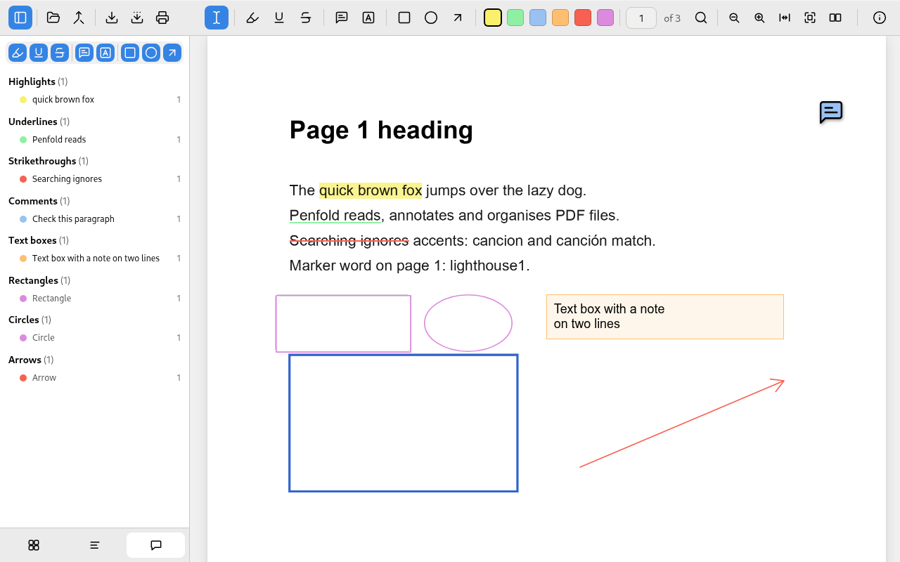
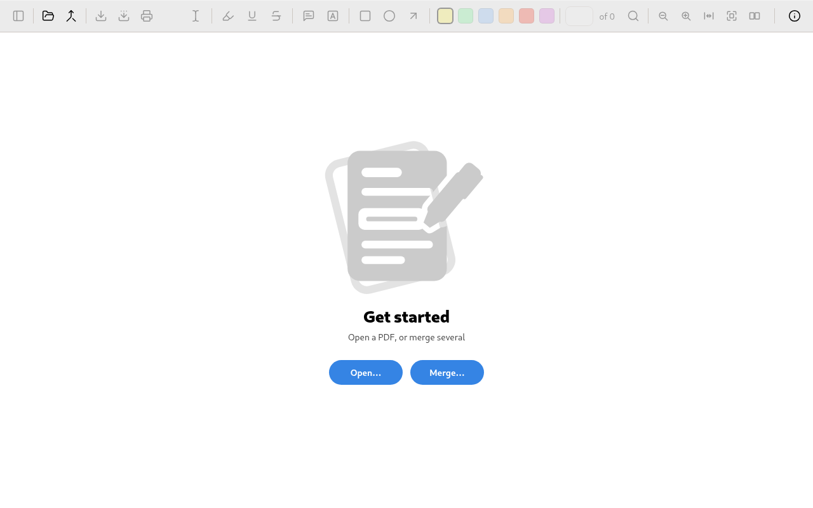
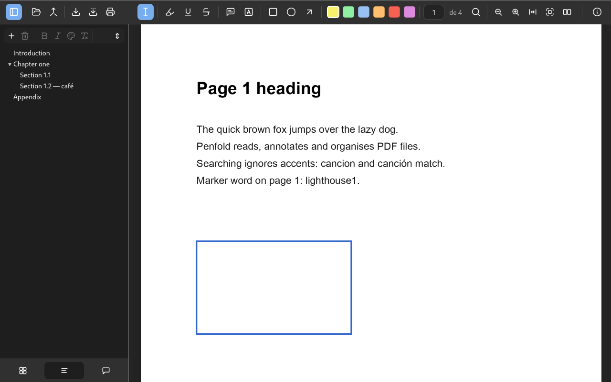

# Penfold — editor de PDF

[English](README.md) · **Español**

Lee, anota y organiza tus PDF, como app de escritorio o en el navegador. Todo se hace en tu equipo: tus documentos no
salen de él, y Penfold funciona sin conexión a internet.



## Funciones

- **Marcadores**: edita el índice del documento — añadir, renombrar, sangrar, reordenar arrastrando, negrita, cursiva
  y color.
- **Anotaciones**: resaltados, subrayados y tachados sobre el texto.
- **Elementos gráficos**: comentarios, cuadros de texto, cuadros, círculos y flechas.
- **Páginas**: combinar varios PDF, extraer, eliminar y girar páginas; también reordenarlas arrastrando y añadir
  páginas en blanco o de otro PDF.

Y además:

- Seis colores, y cada anotación guardada con su propio dibujo, para que se vea igual en cualquier visor de PDF.
- Un panel de Anotaciones que las reúne todas, agrupadas por tipo, para editar su texto, cambiar su color o borrarlas.
- Las anotaciones hechas con otros programas se muestran en solo lectura y se conservan intactas al guardar.
- Lectura con desplazamiento continuo o dos páginas enfrentadas, zoom, miniaturas y búsqueda (sin distinguir
  mayúsculas ni acentos).
- Formularios: rellenar los campos, guardarlos editables o aplanarlos.
- Imprimir, eligiendo qué tipos de anotación se imprimen.
- PDF protegidos (con contraseña de propietario): se pueden leer y anotar en pantalla; Penfold avisa de que todavía
  no puede guardarlos, imprimirlos ni extraer páginas.
- Interfaz en castellano e inglés, según el idioma del sistema; modo claro y oscuro, según el sistema.

| | |
|---|---|
|  |  |

## Cómo usar Penfold

### Como app de escritorio (Debian, Ubuntu y derivadas)

Instala el paquete `penfold_<versión>_amd64.deb` (de las versiones publicadas del proyecto, o construido como se
explica en la parte para desarrolladores):

```bash
sudo apt install ./penfold_<versión>_amd64.deb
```

Penfold aparece entonces en el menú de aplicaciones y en «Abrir con…» para los PDF, y se puede poner como programa
predeterminado para PDF. Abre los PDF desde el gestor de archivos, desde la terminal o soltándolos en su ventana, y
«Guardar» escribe en el archivo abierto. Para desinstalarlo: `sudo apt remove penfold`.

### En el navegador

1. Descarga el proyecto (botón verde **Code** → **Download ZIP**) y descomprímelo, o clónalo con git.
2. Abre `index.html` en el navegador (doble clic).

Eso es todo: no hay nada que instalar ni ningún servidor que poner en marcha.

**Navegadores.** Penfold se desarrolla y se prueba con navegadores basados en Chromium (Chrome, Chromium, Edge,
Brave…). En ellos, «Guardar» sobrescribe el archivo abierto y «Extraer páginas» puede escribir en la carpeta que
elijas. En los navegadores que no tienen esas funciones de archivos, como Firefox, Penfold descarga una copia; ahí no
se prueba de forma habitual.

Para forzar un idioma, añade `?lang=es` o `?lang=en` a la dirección.

## Para desarrolladores

La documentación técnica está en inglés: [README](README.md#for-developers),
[especificación](docs/specification.md), [método de trabajo con IA](docs/working-with-ai.md),
[pruebas](tests/README.md) y [registro de cambios](CHANGELOG.md).

## Licencia

Penfold es software libre, publicado bajo la [Licencia Pública General de GNU, versión 3](LICENSE) (GPL-3.0).

Usa [pdf.js](https://github.com/mozilla/pdf.js) (Apache-2.0), [pdf-lib](https://github.com/Hopding/pdf-lib) (MIT) e
iconos [Lucide](https://lucide.dev/) (ISC); ver [THIRD-PARTY-NOTICES.md](THIRD-PARTY-NOTICES.md).

Creado por ibanurq, con ayuda de IA. © 2026 ibanurq.
