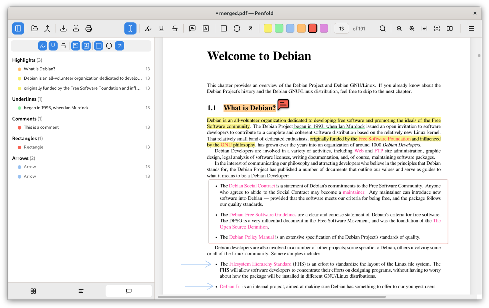

<p align="center">

</p>

# Penfold

[English](README.md) · **Español**

Un lector sencillo de archivos PDF con capacidad para añadir anotaciones y manipular páginas.

La motivación para su desarrollo ha sido contar con una única herramienta, sencilla, y con licencia libre que me permita hacer todo lo que he necesitado con archivos PDF a lo largo de unos cuantos años en mi ordenador personal.

<p align="center">
  
</p>

## Funciones

- **Páginas**: reordenar, extraer, eliminar y girar.
- **Añadir archivos** y páginas en blanco.
- **Combinar archivos** en un único archivo.
- **Marcadores**: añadir, renombrar y reordenar.
- **Anotaciones**: resaltados, subrayados y tachados.
- **Elementos gráficos**: comentarios, cuadros de texto, cuadros, círculos y flechas.
- **Formularios**.

## Capturas

<p align="center">
  
</p>

<p align="center">
  
</p>

<p align="center">
  
</p>

<p align="center">
  
</p>

<p align="center">
  
  
  
</p>

## Detalles

- Arrastrar y soltar con el ratón funciona para cambiar el orden de los archivos que se van a combinar, y para reordenar páginas en la vista de miniaturas y marcadores.
- Atajos de teclado (listado accesible con `Ctrl + ?`).
- Selección múltiple (Mayús o Ctrl) de páginas en la vista de miniaturas y de marcadores.
- Modo claro y oscuro (según el tema del sistema).
- Paleta de 6 colores para las anotaciones y de 8 para los marcadores.
- Panel izquierdo redimensionable.
- La vista de miniaturas adapta su tamaño, de 1 a 4 columnas, según la anchura del panel.
- Lectura con desplazamiento continuo o dos páginas enfrentadas.
- Formularios: se pueden guardar para seguir editándolos, o aplanarlos para enviarlos a terceros.
- Al imprimir se puede elegir qué tipos de anotación se imprimen.
- Aviso en pantalla cuando un archivo está protegido.

Notas importantes:

- Las anotaciones hechas con otros programas son de solo lectura y se conservan intactas al guardar.
- Las anotaciones de tipos no soportados no se muestran, pero se conservan al guardar.

## Idiomas

- Inglés
- Castellano

## Instalación

### App de escritorio

Descarga el paquete `penfold_<versión>_amd64.deb` desde la página de
[versiones publicadas](https://github.com/ibanurq/penfold/releases/latest) e instálalo con:

```bash
sudo apt install ./penfold_<versión>_amd64.deb
```

La aplicación se ha construido y probado en Debian 13.

### En el navegador

Penfold funciona directamente en el navegador, sin necesidad de conexión a la red.

Descarga el archivo `penfold_<versión>-web.zip` desde la página de [versiones publicadas](https://github.com/ibanurq/penfold/releases/latest), descomprímelo y abre `index.html`.

Penfold se ha desarrollado y probado en Google Chrome y Firefox. En los navegadores basados en Chromium, «Guardar»
sobrescribe el archivo abierto y «Extraer páginas» puede escribir en la carpeta que elijas. En los navegadores que no
tienen esas funciones de archivos, como Firefox, se descarga una copia.

Para forzar un idioma, añade `?lang=es` o `?lang=en` a la dirección.

## Notas

- No sé programar, por lo que me he apoyado en la IA para su desarrollo. En el archivo
  [docs/working-with-ai.md](docs/working-with-ai.md) explico la metodología seguida.
- Aunque en su estado actual cumple mis requisitos para usarla en casa, la he probado con archivos reales del trabajo,
  replicando el flujo que empleamos, y el resultado ha sido satisfactorio: combinación de varios archivos, con textos,
  imágenes y planos, con un tamaño final de 50-60 MB y unas 800 páginas.

## Licencia

Penfold es software libre, publicado bajo la [Licencia Pública General de GNU, versión 3](LICENSE) (GPL-3.0).

Usa [pdf.js](https://github.com/mozilla/pdf.js) (Apache-2.0), [pdf-lib](https://github.com/Hopding/pdf-lib) (MIT) e
iconos [Lucide](https://lucide.dev/) (ISC); ver [THIRD-PARTY-NOTICES.md](THIRD-PARTY-NOTICES.md).

Creado por ibanurq, con ayuda de IA. © 2026 ibanurq.
