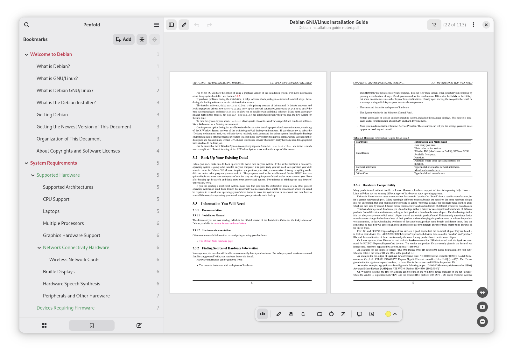
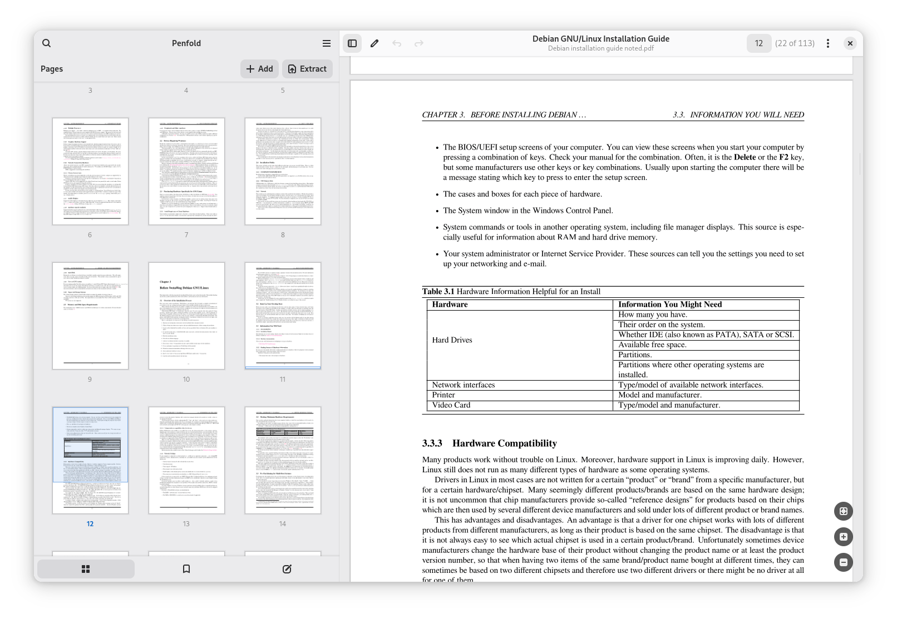
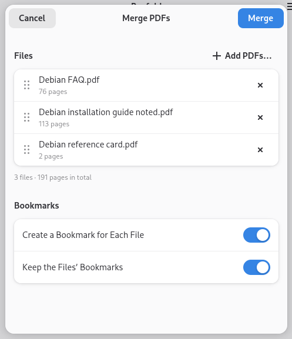
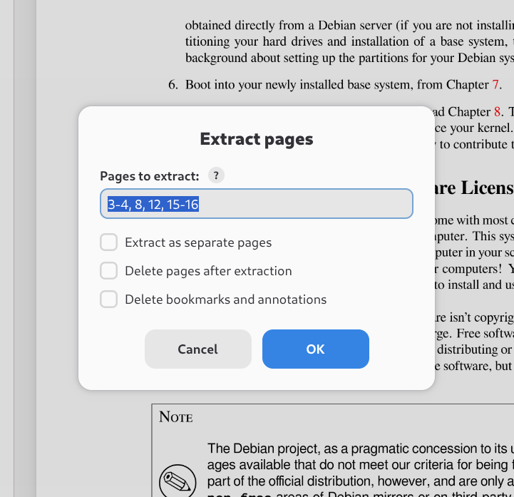

# Penfold

A simple PDF reader that can also add annotations and work with pages.

I made it because I wanted a single, simple, free-licensed tool that lets me do everything I have needed to do with PDF
files on my personal computer over quite a few years.

  

## Features

- **Add pages** from other PDFs, and blank pages.
- **Merge files** into a single file.
- **Pages**: reorder, extract, delete and rotate.
- **Bookmarks**: add, rename, reorder.
- **Annotations**: highlights, underlines and strikethroughs.
- **Graphic elements**: comments, text boxes, rectangles, circles and arrows.
- **Forms**.

## Screenshots

  

  

  

  

  
  
  

## Details

- Drag and drop with the mouse to reorder the files to merge, and to reorder pages in the thumbnail view and bookmarks.
- Keyboard shortcuts (the list opens with `Ctrl + ?`).
- Multiple selection (Shift or Ctrl) of pages in the thumbnail view and of bookmarks.
- Light and dark mode (the document's pages are not inverted).
- Resizable left panel.
- Whether to respect the document's permissions is up to the user (ISO 32000).
- The thumbnail view fits as many thumbnails as the panel's width allows, and you can zoom them in or out.
- Read with continuous scrolling or two pages side by side.
- Elements are edited with the right mouse button: move, change their shape, format, and more. Editing annotations made
  in other programs may be limited.
- Forms can be saved to keep editing them later, or flattened to send them to others.
- When printing, you can choose which kinds of annotations are printed.
- Penfold never runs the code (JavaScript) that a PDF may contain.
- And more!

## Installation

Download [Penfold](https://github.com/ibanurq/penfold/releases/latest/download/penfold.flatpak) and install it with a
double click (your system needs Flatpak and Flathub: [how to set them up](https://flathub.org/setup)).

Or from the terminal:

    flatpak install --user ~/Downloads/penfold.flatpak

I hope it will soon be available on [Flathub](https://flathub.org), with automatic updates.

## Languages

- English
- Spanish

Translations are welcome: open an [issue](https://github.com/ibanurq/penfold/issues) or send a pull request.

## Notes

- Its look is inspired by [Papers](https://apps.gnome.org/Papers/) and the
  [GNOME Human Interface Guidelines](https://developer.gnome.org/hig/).
- I have tried not to clutter the interface, so the editing tools are mostly reached with the right mouse button, and
  the annotation tools have to be turned on. This last behavior can be changed.
- I don't know how to program, so I relied on AI to develop it. In
  [docs/working-with-ai.md](docs/working-with-ai.md) I explain the method I followed.
- Although in its current state it meets my needs for home use, I have also tried it with real files from work,
  following the workflow we use there, and the result was satisfactory: merging several files with text, images and
  drawings, into a final file of 50–60 MB and about 800 pages.
- Thanks to the whole free software community. Penfold would not have been possible without it.

## Support Penfold

Penfold is free of charge and will stay that way. If you find it useful and would like to support its development, you
can buy me a coffee:

  

You can also help by reporting bugs, suggesting improvements or translating the app into your language.

## License

Penfold is free software, released under the [GNU General Public License, version 3](LICENSE) (GPL-3.0).
