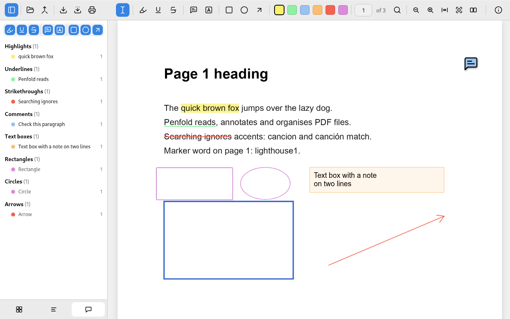
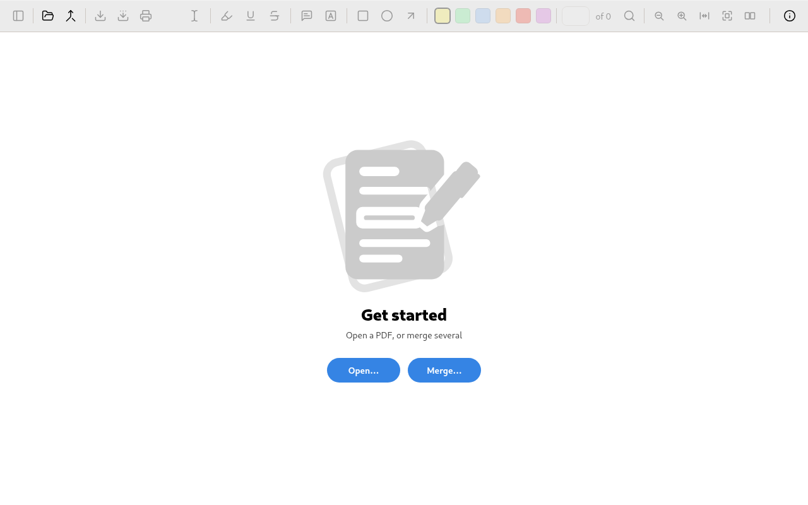
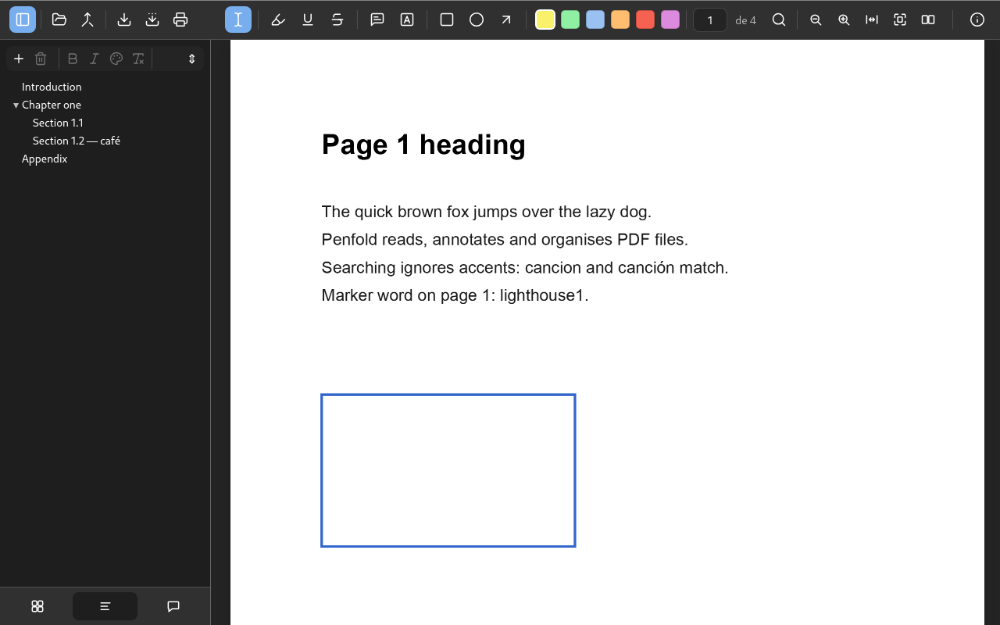

# Penfold — PDF editor

**English** · [Español](README.es.md)

Read, annotate and organise your PDFs, as a desktop app or in your browser. Everything happens on your computer: your
documents never leave it, and Penfold works without an internet connection.



## Features

- **Bookmarks**: edit the document’s outline — add, rename, indent, reorder by dragging, bold, italic and colour.
- **Annotations**: highlights, underlines and strikethroughs on the text.
- **Graphic elements**: comments, text boxes, rectangles, circles and arrows.
- **Pages**: merge several PDFs, extract, delete and rotate pages; also reorder them by dragging and add blank pages
  or pages from another PDF.

And also:

- Six colours, and every annotation saved with its own drawing, so it looks the same in any PDF viewer.
- An Annotations panel listing them all, grouped by type, to edit their text, change their colour or delete them.
- Annotations made with other programs are shown read-only and kept intact when you save.
- Reading in continuous scroll or two pages side by side, with zoom, thumbnails and find (ignoring case and accents).
- Forms: fill in fields, save them still editable, or flatten them.
- Printing, choosing which kinds of annotation are printed.
- Protected PDFs (with an owner password) can be read and annotated on screen; Penfold warns that it cannot save,
  print or extract them yet.
- English and Spanish interface, following the system’s language; light and dark mode, following the system.

| | |
|---|---|
|  |  |

## Using Penfold

### As a desktop app (Debian, Ubuntu and derivatives)

Install the package `penfold_<version>_amd64.deb` (from the project’s releases, or built as explained under “For
developers”):

```bash
sudo apt install ./penfold_<version>_amd64.deb
```

Penfold then appears in the applications menu and in “Open with…” for PDFs, and can be made the default PDF
application. It opens PDFs from the file manager, the command line or dropped on its window, and “Save” writes back to
the opened file. To uninstall it: `sudo apt remove penfold`.

### In the browser

1. Download the project (green **Code** button → **Download ZIP**) and unzip it, or clone it with git.
2. Open `index.html` in your browser (double-click it).

That is all: there is nothing to install and no server to run.

**Browsers.** Penfold is developed and tested with Chromium-based browsers (Chrome, Chromium, Edge, Brave…). There,
“Save” overwrites the file you opened and “Extract pages” can write into a folder you choose. In browsers without
those file features, such as Firefox, Penfold falls back to downloading a copy; it is not routinely tested there.

To force a language, add `?lang=en` or `?lang=es` to the address.

## For developers

Penfold is plain HTML, CSS and JavaScript with no build step:

```
index.html           page structure (toolbar, side panel, welcome screen)
css/penfold.css      styles (GNOME / libadwaita look, light and dark)
js/penfold.js        the whole application
electron/            the desktop app: window and desktop integration (npm start)
vendor/              pdf.js 3.11.174 and pdf-lib 1.17.1, unchanged (see vendor/README.md)
tests/               automatic tests (Playwright) and test PDFs
docs/                specification and working method
```

Automatic tests drive the real app in a headless Chromium and compare it with reference screenshots pixel by
pixel. They need Node.js:

```bash
npm install
npx playwright install chromium
npm test
```

See [tests/README.md](tests/README.md) for details. The code is formatted with Prettier (`npm run format`) and checked
with ESLint (`npm run lint`).

The desktop app uses [Electron](https://www.electronjs.org/):

```bash
npm start           # run it from the project folder
npm run dist        # build the Debian package in dist/
npm run test:dist   # run the desktop tests against the built app
npm run icons       # rebuild the PNG icons after changing assets/penfold.svg
npm run screenshots # rebuild the README images after a visual change
```

- [docs/specification.md](docs/specification.md): what Penfold does and how it looks, in enough detail to rebuild it.
- [docs/working-with-ai.md](docs/working-with-ai.md): how Penfold is developed with an AI assistant.
- [CHANGELOG.md](CHANGELOG.md): what changed in each version.

## Licence

Penfold is free software, released under the [GNU General Public Licence v3.0](LICENSE).

It uses [pdf.js](https://github.com/mozilla/pdf.js) (Apache-2.0), [pdf-lib](https://github.com/Hopding/pdf-lib) (MIT)
and [Lucide](https://lucide.dev/) icons (ISC); see [THIRD-PARTY-NOTICES.md](THIRD-PARTY-NOTICES.md).

Created by ibanurq, with AI assistance. © 2026 ibanurq.
