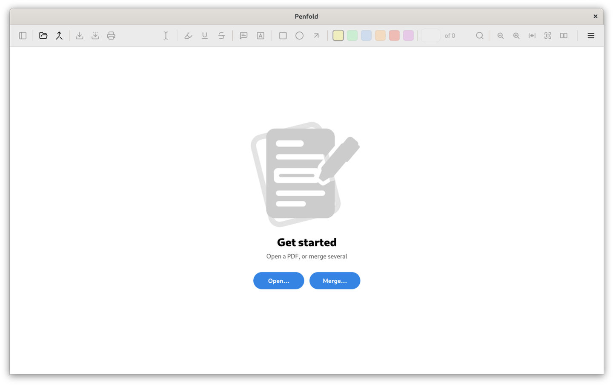
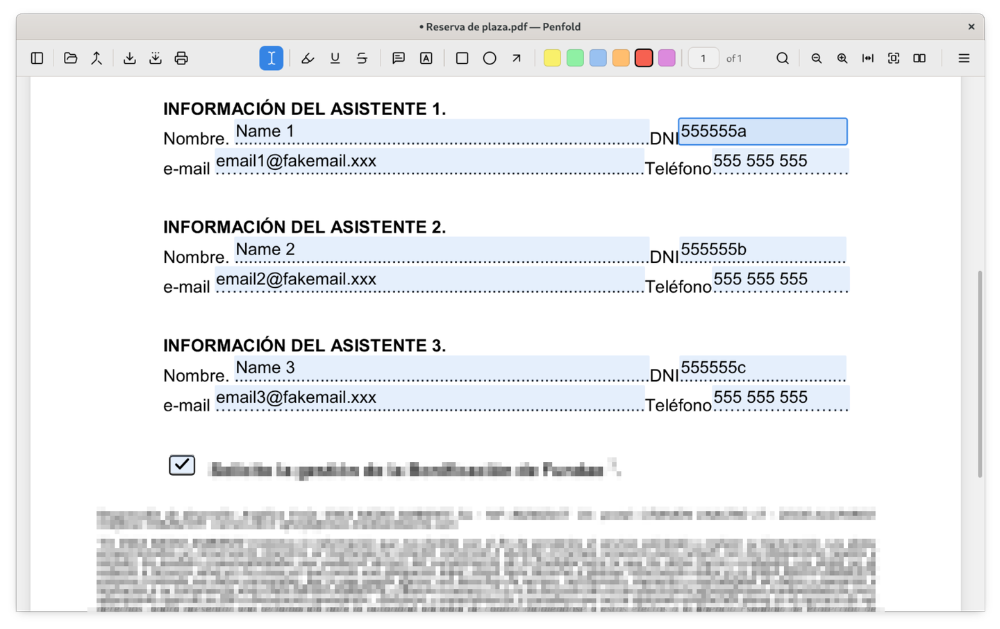
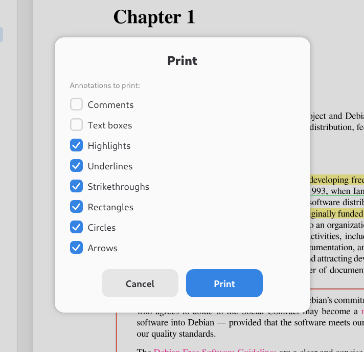

<p align="center">

</p>

# Penfold

**English** · [Español](README.es.md)

A simple PDF reader that can also add annotations and work with pages.

I made it because I wanted a single, simple, free-licensed tool that lets me do everything I have needed to do with PDF
files on my personal computer over quite a few years.

<p align="center">
  
</p>

## Features

- **Pages**: reorder, extract, delete and rotate.
- **Add files** and blank pages.
- **Merge files** into a single file.
- **Bookmarks**: add, rename and reorder.
- **Annotations**: highlights, underlines and strikethroughs.
- **Graphic elements**: comments, text boxes, rectangles, circles and arrows.
- **Forms**.

## Screenshots

<p align="center">
  
</p>

<p align="center">
  
</p>

<p align="center">
  
</p>

<p align="center">
  
</p>

<p align="center">
  
  
  
</p>

## Details

- Drag and drop with the mouse to change the order of the files to merge, and to reorder pages in the thumbnail view
  and bookmarks.
- Keyboard shortcuts (listed with `Ctrl + ?`).
- Multiple selection (Shift or Ctrl) of pages in the thumbnail view and of bookmarks.
- Light and dark mode (following the system’s theme).
- A palette of 6 colours for annotations and 8 for bookmarks.
- Resizable left panel.
- The thumbnail view adapts its size, from 1 to 4 columns, to the width of the panel.
- Reading in continuous scroll or two pages side by side.
- Forms can be saved to keep editing them, or flattened to send them to others.
- When printing you can choose which kinds of annotation are printed.
- On-screen notice when a file is protected.

Important notes:

- Annotations made with other programs are read-only and are kept intact when saving.
- Annotations of unsupported types are not shown, but they are kept when saving.

## Languages

- English
- Spanish

## Installation

### Desktop app

Download the package `penfold_<version>_amd64.deb` from the
[releases page](https://github.com/ibanurq/penfold/releases/latest) and install it with:

```bash
sudo apt install ./penfold_<version>_amd64.deb
```

The app has been built and tested on Debian 13.

### In the browser

Penfold works directly in the browser, without a network connection.

Download the file `penfold_<version>-web.zip` from the [releases page](https://github.com/ibanurq/penfold/releases/latest),
unzip it and open `index.html`.

Penfold has been developed and tested in Google Chrome and Firefox. In Chromium-based browsers, “Save” overwrites the
opened file and “Extract pages” can write into a folder you choose. In browsers without those file features, such as
Firefox, a copy is downloaded instead.

To force a language, add `?lang=en` or `?lang=es` to the address.

## Notes

- I cannot program, so I relied on AI to develop it. The file [docs/working-with-ai.md](docs/working-with-ai.md)
  explains the method I followed.
- Although in its current state it meets my needs for home use, I have tested it with real files from work,
  reproducing the workflow we use, with good results: merging several files with text, images and plans, into a final
  file of 50–60 MB and about 800 pages.

## Licence

Penfold is free software, released under the [GNU General Public Licence v3.0](LICENSE) (GPL-3.0).

It uses [pdf.js](https://github.com/mozilla/pdf.js) (Apache-2.0), [pdf-lib](https://github.com/Hopding/pdf-lib) (MIT)
and [Lucide](https://lucide.dev/) icons (ISC); see [THIRD-PARTY-NOTICES.md](THIRD-PARTY-NOTICES.md).

Created by ibanurq, with AI assistance. © 2026 ibanurq.
